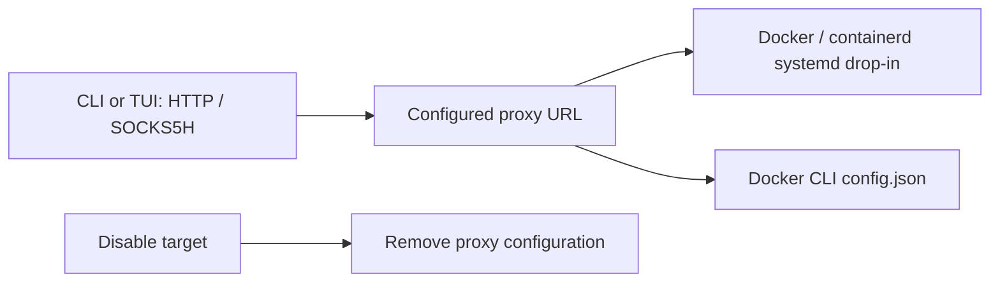
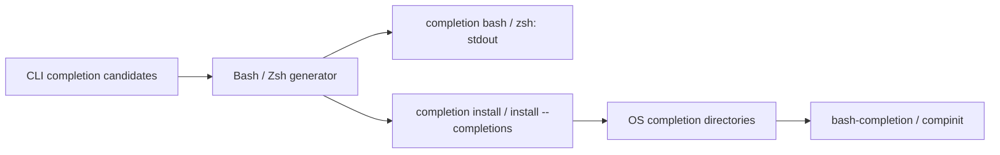

# QProxy

Proxy management for system environment, package managers, Docker, containerd, and proxychains. Interactive TUI or CLI.

**Platforms:** Linux (Debian, Ubuntu, Fedora, RHEL, Arch, OpenSUSE, …) and **macOS** (Homebrew + Docker Desktop)  
**Version:** git tag / `VERSION` file / `v2.1.0` default — see [Versioning](#versioning)  
**Author:** Hamid Naeemabadi

## Quick start

```bash
git clone https://github.com/hamidnaeemabadi/qproxy.git
cd qproxy
chmod +x qproxy.sh

sudo ./qproxy.sh install              # install to /usr/local, install deps
sudo ./qproxy.sh install --proxychains-conf   # also seed proxychains conf

sudo qproxy                           # interactive menu
qproxy config show                    # show current settings
```

### macOS

```bash
# Homebrew required for deps / pkgmgr / proxychains
brew install dialog jq curl

sudo ./qproxy.sh install              # uses brew for dialog/jq/curl
sudo qproxy enable os-env http
sudo qproxy enable pkgmgr             # Homebrew proxy env
qproxy enable docker-cli              # ~/.docker/config.json (no sudo)
qproxy enable docker                  # Docker Desktop daemon.json
```

## Requirements

| | Linux | macOS |
|---|--------|--------|
| OS | Debian, Ubuntu, Fedora, RHEL, Arch, OpenSUSE, … | macOS 13+ (tested on macOS 27) |
| Privileges | Root for enable/disable/install | Root for system os-env / install; docker-cli & Docker Desktop daemon can be user-scoped |
| Deps | `dialog`, `jq`, `curl` (auto via apt/dnf/…) | Same via Homebrew |
| Package manager target | apt / dnf / pacman / zypper | **Homebrew** |
| Docker | systemd Docker + CLI | **Docker Desktop** (`daemon.json` + CLI) |
| containerd | systemd drop-in | Not available (use Docker Desktop) |
| Proxychains | `/etc/proxychains4.conf` | `$(brew --prefix)/etc/proxychains.conf` |

```bash
sudo ./qproxy.sh install --no-deps   # skip dialog/jq/curl package install
qproxy install status              # check install location
```

## Versioning

Version is resolved in this order:

1. **`$QPROXY_ROOT/VERSION`** — written on `sudo qproxy install` (used on installed systems)
2. **Git tag** — `git describe --tags` when running from a git checkout
3. **Fallback** — `v2.1.0` in `lib/config.sh` (`QPROXY_DEFAULT_VERSION`)

**Release v2.1.0:**

```bash
git tag -a v2.1.0 -m "Release v2.1.0"
git push origin v2.1.0

# Re-install so /usr/local/lib/qproxy/VERSION is updated
sudo ./qproxy.sh install
qproxy install status   # → QProxy v2.1.0
```

**Already installed without re-installing:** update the version file only:

```bash
echo v2.1.0 | sudo tee /usr/local/lib/qproxy/VERSION
qproxy install status
```

**Note**: The script detects your platform and installs dependencies accordingly:

- **Debian/Ubuntu**: `apt` (proxychains4)
- **Fedora/RHEL/CentOS**: `dnf`/`yum` (proxychains-ng)
- **Arch/Manjaro**: `pacman` (proxychains-ng)
- **OpenSUSE/SLES**: `zypper` (proxychains-ng)
- **macOS**: Homebrew (`dialog`, `jq`, `curl`, `proxychains-ng`)

## Configuration

Proxy settings live in **`~/.qproxy.env`** (created on first run). Edit directly or use the TUI **Configure Proxy Settings** menu.

```bash
# ~/.qproxy.env
HTTP_HOST="10.X.X.X"
HTTP_PORT="3128"
SOCKS5_HOST="10.X.X.X"
SOCKS5_PORT="1080"
NO_PROXY_HOSTS="127.0.0.0/8,10.0.0.0/8,172.16.0.0/12,192.168.0.0/16,localhost,*.local"
PROXY_TIMEOUT=30
PROXY_READ_TIMEOUT=60
```

`qproxy config show` prints the active values and config path.

## CLI

Most commands need root (`sudo qproxy …`). Exceptions: `config show`, `install status`, `test health`, `docker-cli`, and on macOS `docker` (Docker Desktop user daemon.json).

| Command | Description |
|---------|-------------|
| `qproxy` | Interactive TUI (default) |
| `qproxy -h` | Show CLI help |
| `qproxy install [options]` | Install under `/usr/local` (or `--prefix`) |
| `qproxy install status` | Show install path and version |
| `qproxy uninstall` | Remove system install (keeps `~/.qproxy.env`) |
| `qproxy config show` | Show HTTP/SOCKS5 hosts, NO_PROXY, timeouts |
| `qproxy enable <target> [type]` | Enable proxy on a service |
| `qproxy disable <target>` | Disable proxy on a service |
| `qproxy test <check> [type]` | Run connectivity / health tests |

### Install options

| Option | Description |
|--------|-------------|
| `--no-deps` | Skip installing `dialog`, `jq`, `curl` |
| `--completions` | Install Bash and Zsh completions in OS completion directories |
| `--proxychains-conf` | Install bundled proxychains conf if missing |
| `--force-proxychains-conf` | Replace existing proxychains conf |
| `--prefix PATH` | Install under `PATH` instead of `/usr/local` |

### Targets (`enable` / `disable`)

| Target | Linux | macOS |
|--------|-------|-------|
| `os-env` | `/etc/profile.d/user_proxy_env.sh` | `$(brew --prefix)/etc/qproxy/…` sourced from `/etc/zprofile` + `/etc/profile` |
| `apt` | APT http/socks5 | N/A |
| `pkgmgr` | Auto distro PM | Homebrew |
| `docker` | systemd drop-in | Docker Desktop `~/.docker/daemon.json` proxies |
| `docker-cli` | all users + `/etc/skel` | current user only |
| `containerd` | systemd drop-in | N/A |
| `proxychains` | `/etc/proxychains4.conf` | brew `etc/proxychains.conf` |

### Tests (`test`)

| Check | Type | Description |
|-------|------|-------------|
| `health` | `http` \| `socks5` | Proxy reachability before applying config |
| `apt` | — | APT proxy test (Linux) |
| `pkgmgr` | — | Package manager / Homebrew proxy test |
| `docker` | — | Docker / Docker Desktop proxy test |
| `containerd` | — | Containerd proxy test (Linux) |
| `proxychains` | — | Proxychains chain test |

### Examples

```bash
# Install
sudo ./qproxy.sh install
sudo qproxy install --no-deps --prefix /opt
qproxy install status

# View config
qproxy config show

# Enable proxies (sudo where required)
sudo qproxy enable os-env http
sudo qproxy enable apt socks5          # Linux
sudo qproxy enable pkgmgr              # Homebrew on macOS
sudo qproxy enable docker
qproxy enable docker-cli
sudo qproxy enable docker socks5h       # Linux Docker Engine
qproxy enable docker-cli socks5h
sudo qproxy enable containerd socks5h   # Linux
sudo qproxy enable proxychains dual

# Disable
sudo qproxy disable docker
qproxy disable docker-cli
sudo qproxy disable containerd
sudo qproxy disable os-env

# Tests
qproxy test health http
sudo qproxy test docker
sudo qproxy test proxychains

# Remove install
sudo qproxy uninstall
```

Docker Engine (Linux), Docker CLI, and containerd accept `http` (default) or
`socks5h` when enabling a proxy; `socks5` is also accepted and produces a
`socks5h://` URL. SOCKS5H uses `SOCKS5_HOST` / `SOCKS5_PORT` from `~/.qproxy.env`.
Enabling a mode replaces the target's previous mode. The same `disable` command
removes either mode; the TUI offers both enable modes and a shared disable action.



Docker CLI settings apply to **new containers and builds**, whose applications
must support SOCKS5H; they do not proxy daemon image pulls. See the
[Docker CLI proxy documentation](https://docs.docker.com/engine/cli/proxy/).
Docker Desktop ignores `daemon.json` proxy settings, so QProxy's Docker SOCKS5H
option on macOS reports instructions without writing a configuration or restarting
Desktop. Enable or disable its proxy under **Settings > Resources > Proxies**;
see [Docker Desktop proxy settings](https://docs.docker.com/desktop/settings-and-maintenance/settings/#proxies).
Containerd remains Linux-only. Applying or removing service proxies uses the
existing service restart behavior; validate on a test host before production use.

## Shell completion

Install both shell completions with QProxy or add them to an existing install:

```bash
sudo ./qproxy.sh install --completions
sudo qproxy completion install

# Generate scripts without installing or requiring sudo
qproxy completion bash > qproxy.bash
qproxy completion zsh > _qproxy
```

Completion covers commands, targets, proxy modes (including SOCKS5H), install
options, and directories after `install --prefix`. On Linux it installs under
`/usr/local/share/bash-completion/completions/qproxy` and
`/usr/local/share/zsh/site-functions/_qproxy` (or the selected install prefix).
On macOS it uses Homebrew's `etc/bash_completion.d/qproxy` and
`share/zsh/site-functions/_qproxy`, falling back to `/usr/local` without Homebrew.
`qproxy uninstall` removes QProxy-generated completions from these locations.

Restart the shell after installation. Bash must already load the `bash-completion`
framework; Zsh must run `autoload -Uz compinit; compinit` with the completion
directory in `$fpath`. On Homebrew, run `brew shellenv` in shell startup before
initializing completion. QProxy does not edit shell startup files or install a
completion framework. See [Homebrew shell completion](https://docs.brew.sh/Shell-Completion)
and [Bash completion setup](https://github.com/scop/bash-completion#installation).
Custom prefixes must also be included in the shell's completion search path.



## Proxychains

Proxy hosts/ports come from `~/.qproxy.env`. QProxy writes the proxychains conf from templates when you enable a mode.

```bash
# 1. Set proxy endpoints (edit file or use TUI)
qproxy config show

# 2. Configure proxychains (pick one)
sudo qproxy enable proxychains http
sudo qproxy enable proxychains socks5
sudo qproxy enable proxychains dual      # HTTP + SOCKS5 chain

# 3. Verify the chain works
sudo qproxy test proxychains

# 4. Run a single command through the proxy
proxychains4 curl -s http://httpbin.org/ip
proxychains4 wget -qO- https://example.com
proxychains4 git clone https://github.com/example/repo.git

# 5. Interactive shell with all traffic proxied (TUI only)
sudo qproxy    # → Configure Proxychains → Launch Proxychains Shell

# 6. Disable / reset
sudo qproxy disable proxychains
```

**Install bundled base config** (optional, on first install):

```bash
sudo qproxy install --proxychains-conf
```

More detail: [docs/proxychains-config-guide.md](docs/proxychains-config-guide.md)

## Interactive menu

Run `sudo qproxy` with no arguments:

1. Configure proxy settings  
2. Enable / disable proxy (OS, pkgmgr/Homebrew, Docker, …)  
3. Test proxies (health, performance, per-service)  
4. Configure proxychains (HTTP, SOCKS5, dual, shell launcher)  
5. Apply proxy to current session (no logout)

On macOS the TUI omits APT and containerd; package manager means Homebrew.

Proxychains details: [docs/proxychains-config-guide.md](docs/proxychains-config-guide.md)

## Troubleshooting

| Issue | What to check |
|-------|----------------|
| Health check fails | Host/port in `~/.qproxy.env`, firewall, proxy auth |
| APT still slow | `sudo qproxy disable apt` then re-enable; `apt clean` |
| Docker restart (Linux) | Live-restore in daemon config; check `docker.service.d/proxy.conf` |
| Docker Desktop (macOS) | `~/.docker/daemon.json` proxies; relaunch Docker.app |
| Homebrew ignores proxy | New shell after `pkgmgr` enable; check brew etc env file |

Config paths:

- **APT Proxy**: `/etc/apt/apt.conf.d/apt_proxy_*` (Linux)
- **Homebrew Proxy**: `$(brew --prefix)/etc/qproxy-homebrew-proxy.env.sh` (macOS)
- **Docker Service Proxy (Linux)**: `/etc/systemd/system/docker.service.d/proxy.conf`
- **Docker Desktop (macOS)**: `~/.docker/daemon.json` (`proxies`)
- **Docker CLI Proxy**: `~/.docker/config.json`
- **OS Environment (Linux)**: `/etc/profile.d/user_proxy_env.sh`
- **OS Environment (macOS)**: `$(brew --prefix)/etc/qproxy/user_proxy_env.sh` via `/etc/zprofile`

## Changelog

See [CHANGELOG.md](CHANGELOG.md).

## Contributing

1. Fork the repository
2. Create a feature branch
3. Make your changes
4. Test thoroughly
5. Submit a pull request

## License

MIT — see [LICENSE](LICENSE).
